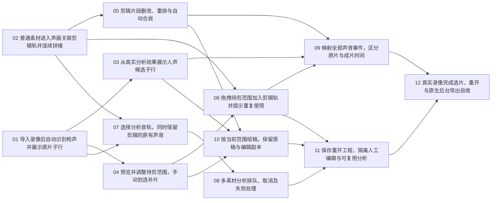

# FilmCraft AI 识别与选片：已发布工单与依赖

迁移说明（2026-10-16）：本目录是已批准工单的开发快照，实施工作转到 FilmCraft。GitHub 工单仍在 Apex 的 #21–#32；转移工单是后续独立步骤。

状态：**已发布 GitHub 并完成核验**。2026-10-14。12 张票为 #21–#32，全部带 `ready-for-agent`，19 条原生阻塞关系已设置；见[发布清单与依赖](published.md)。

初稿依据当前分支 `codex/grill-ai-selection-decisions` 的设计提交 `db9dd86f070682163614442cfc9c63cf7eccfc10`，采用 [Q1–Q19 定稿](../design/recognition-workspace.md)、[术语表](../GLOSSARY.md)及 ADR 0003–0005。2026-10-14 已与新增网页原型提交 `978fed1580fdf85d34e2b5c17f973693c5510693` 对照：声画关联单轨、自动拼接已同步，12 张票的范围与依赖继续有效。原型的撤销、坐标及其他未覆盖能力按票中验收实现，不能直接以演示行为作为最终规则；详见[原型与工单一致性核对](../reviews/prototype-compatibility.md)。

既有 tracker 配置在先前工作树中确认为 GitHub `jackliu1111/apex-fps-mvp`；本次实时核对到 `ready-for-agent` 标签和旧 #3–#18 均已关闭，未发现本轮重复票。当前分支未包含旧 tracker 说明文件，本次未重建它。来源是设计文档，无来源父 Issue。用户已确认拆分，现已按依赖顺序发布独立 Issues，设置原生阻塞关系与 `ready-for-agent` 标签，并完成逐票正文、标签、状态及依赖读回核验。

## 交付边界

2026-10-14 已完成逐票原生能力核对，并在各票正文明确复用与实际改造范围，详见[原生能力复用核对](../reviews/native-capability-audit.md)。范围手柄、素材拖入、关联编辑、帧定位、撤销、工程保存和后台导出都有现成基础；新工作集中于识别与选片的工程状态、分类子行、连续剪辑轨语义和动态事件映射。12 张票继续按可独立验收的行为切片组织。

本轮是 FilmCraft 本机原生 AI 识别与选片改造。复用现有 Python 推理、缓存、组稿原稿／编辑副本及原生导出；01 的第一步先解耦分析完成和自动组稿。没有证据支持先做一轮全仓大重构。02 可以独立用普通素材打通连续剪辑轨，与 01 并行。

各票都包含可演示的行为和验收条件。新增领域状态由对应票负责随工程保存；11 验收跨功能恢复与隔离。09 的标记映射是已保存数据的投影，因此不阻塞 11。07 可用普通素材验证多音轨保留，不等待 AI 拖拽；10 的主动组稿也不依赖拖拽入口。

## 已批准拆分

1. **[导入录像后自动识别枪声并展示原片子行](01-import-gunshot-recognition.md)**  
   阻塞：无，可立即开始。在 FilmCraft 导入单音轨本地录像后自动分析，在主时间线原片 A1 下浏览枪声候选并定位源预览，分析完成只更新识别结果。实施开头先将现有分析结果接收与主动组稿解耦，再接入新入口；复用现有推理、缓存与原生媒体能力。

2. **[普通素材进入声画关联剪辑轨并连续拼接](02-contiguous-editing-track.md)**  
   阻塞：无，可立即开始。用户把普通原生素材范围拖入一条剪辑轨，画面与关联声音作为同一个编辑单元追加或插入，并能保存、播放和用原生导出检查成片。连续拼接由目标剪辑轨决定，后续 AI 选片复用同一规则。

3. **[从真实分析结果展示人声候选子行](03-voice-recognition-lane.md)**  
   阻塞：01。用户在同一原片 A1 下同时看到枪声、人声两类真实候选，能独立展开和定位。复用已保存的完整类别分数提取人声事件，不增加转写、说话人判断或声音分离。

4. **[预览并调整待剪范围，手动划选补片](04-edit-selection-ranges.md)**  
   阻塞：01。用户点击识别高亮后调整独立的待剪范围，拖动边界查看对应画面，也可在无高亮区域划选补片；修改支持键盘与撤销，始终保留模型事件。

5. **[剪辑片段删改、重排与自动合拢](05-edit-ripple-reorder.md)**  
   阻塞：02。复用原生片段拖动、关联声画、波纹裁边／删除和撤销，适配剪辑轨连续排列；重排后的原位置合拢、目标边界插入和声音同步作为验收重点。

6. **[拖拽待剪范围加入剪辑轨并提示重复使用](06-drag-ai-selections.md)**  
   阻塞：02、04。用户拖动识别高亮主体或手动划选范围，复用普通素材的目标轨规则创建独立声画片段；也能用 Shift+Enter 追加。创建时提示重复或重叠，允许重复内容。

7. **[选择分析音轨，同时保留剪辑的原有声音](07-multitrack-analysis-and-retention.md)**  
   阻塞：01、02。导入多音轨录像时，用户先试听并选择供模型分析的音轨，再把素材范围放入剪辑轨；成片默认保留原有声音，选择游戏声分析不会丢弃麦克风或队伍语音。

8. **[多素材分析排队、取消及失败处理](08-analysis-queue-and-failure.md)**  
   阻塞：07。一次导入多个素材后，应用有序分析并展示每项状态，用户可继续预览编辑、取消或重试；多音轨素材先等待用户选择，不把未完成分析显示为没有声音。

9. **[映射全部声音事件，区分原片与成片时间](09-event-mapping-and-time-coordinates.md)**  
   阻塞：03、05、06。用户在剪辑轨看到每个片段范围内全部枪声、人声事件，并能理解成片位置对应哪段原片；裁边、删除、重排和重复使用后，标记及使用提示保持准确。

10. **[按当前范围组稿，保留原稿与编辑副本](10-assemble-current-ranges.md)**  
   阻塞：03、04、05。用户主动对当前原片执行“按当前范围生成草稿”，采用已调整范围，按原片顺序合并重叠区间，得到新的组稿原稿与编辑副本，同时保留已有手动剪辑。扩展已有原稿／副本能力。

11. **[保存重开工程，隔离人工编辑与可复用分析](11-project-recovery-and-cache-isolation.md)**  
   阻塞：06、08、10。用户保存并重开工程后继续同一份识别与剪辑工作；另一工程使用相同素材时只能复用匹配的完成分析，不能带入人工范围。中断任务由用户主动继续。各前置票已负责新增状态的保存，本票完成跨功能恢复一致性。

12. **[真实录像完成选片、重开与原生后台导出验收](12-real-recording-workflow-acceptance.md)**  
   阻塞：09、11。从真实录像导入到人工选片、组稿、保存重开和 FilmCraft 原生后台导出，验证这轮原生改造完整可用，记录模型效果、长录像表现和操作效率；修复暴露出的集成问题。

## 依赖图

## 批准与执行

- 用户已批准调整后的 12 张票，包括每票的原生能力复用边界。
- 19 条阻塞边已设置并读回核验；当前可启动的前沿是 01／#21 和 02／#22。
- 按实时 GitHub 原生阻塞关系选择可执行任务；验收通过后才能完成工单。

逐票正文位于当前目录，每票一个文件；[依赖与需求映射](manifest.json)供发布前一致性核验。用户批准的暂存正文已发布；GitHub 工单编号及真实阻塞关系见发布清单。

